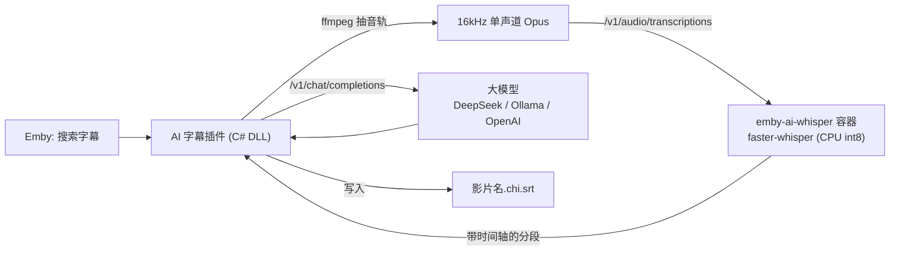

# Emby AI 字幕

给 **Emby（Docker 版）** 里没有字幕的电影、剧集生成字幕：
**Whisper 语音识别 → 大模型翻译 → 输出双语 / 中文 SRT**。



## 目录结构

| 路径 | 说明 |
| --- | --- |
| `plugin/Emby.AiSubtitles/` | Emby 插件源码（netstandard2.0，兼容 Emby 4.8 / 4.9） |
| `whisper-service/` | faster-whisper 语音识别服务（OpenAI 兼容接口） |
| `docker-compose.yml` | Emby + 识别服务的部署示例 |

## 部署

### 1. 启动识别服务

把 `emby-ai-whisper` 加到你 Emby 所在的 compose 里（参考 [docker-compose.yml](docker-compose.yml)），**两个容器要在同一个 Docker 网络**：

```bash
docker compose up -d --build emby-ai-whisper
docker logs -f emby-ai-whisper   # 首次启动会下载模型，看到“模型加载完成”即可
```

纯 CPU 模型选择参考（2 小时电影，4 核 NAS 粗略估计）：

| 模型 | 内存 | 耗时 | 准确率 |
| --- | --- | --- | --- |
| `base` | ~0.5 GB | 20~40 分钟 | 一般 |
| `small`（默认） | ~1 GB | 40~90 分钟 | 较好 |
| `medium` | ~2.5 GB | 2~4 小时 | 好 |

> CPU 吃力时把 `WHISPER_BEAM_SIZE` 改为 `1` 可以明显提速。国内下载模型慢可设置 `HF_ENDPOINT=https://hf-mirror.com`。

### 2. 编译并安装插件

任选一种方式得到 `Emby.AiSubtitles.dll`：

- **Docker 编译（无需装 .NET）**：
  ```bash
  docker build -f plugin/Dockerfile.build --output type=local,dest=./dist plugin
  ```
- **本机 .NET 8 SDK**：
  ```bash
  dotnet build plugin/Emby.AiSubtitles/Emby.AiSubtitles.csproj -c Release -o dist
  ```
- **GitHub Actions**：推送到 GitHub 后在 Actions 的构建产物里下载。

把 DLL 复制到 Emby 配置卷的 `plugins/` 目录（容器内 `/config/plugins/`），然后重启 Emby。

### 3. 配置插件

Emby 控制台 → 插件 → **AI 字幕**：

- **Whisper 接口地址**：`http://emby-ai-whisper:8000/v1`
- **大模型**：例如 DeepSeek：`https://api.deepseek.com/v1` + 你的 Key + `deepseek-chat`；
  本地 Ollama：`http://<ollama地址>:11434/v1` + 模型名（如 `qwen2.5:7b`），Key 留空
- **字幕内容与格式**：
  - 默认生成 **`.ass` 特效字幕**：显式锁定**屏幕正下方居中**（`Alignment=2`），第一行中文为**白色大字（#FFFFFF）**，第二行英文为**黄色小字（#FFD700）**，避免播放器把双语字幕顶到画面最上方。
  - 也支持切换为带 `<font color>` 标签的 `.srt` 字幕，并可在设置页自定义主/副字幕颜色。
- **实时多任务进度面板**：插件设置页顶部每 2 秒自动刷新所有排队、抽取音轨、语音识别、大模型翻译的实时进度与耗时。

> [!IMPORTANT]
> 还要在 **媒体库设置 → 字幕下载器** 里勾选启用「AI 字幕」，否则搜索字幕时不会出现。

## 使用

1. 打开一部没有字幕的影片 → `...` → **编辑字幕** → 选择语言（如 Chinese）→ **搜索**
2. 选择 **「AI 字幕 · 点击开始生成 (ASS)」** 并下载
3. Emby 会先保存一条“AI 字幕生成中”的占位字幕；后台完成后插件会**自动覆盖成正式字幕**并刷新条目
4. 可以随时在 **控制台 → 插件 → AI 字幕** 顶部的「实时任务进度」面板查看所有并发/排队任务的进度条，或在影片「编辑字幕 → 搜索」里查看单部进度

## 已知限制

- Emby 的字幕下载接口是同步的，所以采用“占位字幕 + 后台生成 + 覆盖”的方式；任务状态保存在内存里，**重启 Emby 会丢失正在进行的任务**（已完成的结果会缓存在插件数据目录）。
- 默认使用影片的**第一条音轨**。
- 默认不参与媒体库的“自动下载字幕”，避免扫库时排满 CPU；需要的话可在设置中打开。
- 使用 OpenAI 云端 Whisper 时有 25MB 上传限制，Opus 24kbps 大约可容纳 2 小时音频。
